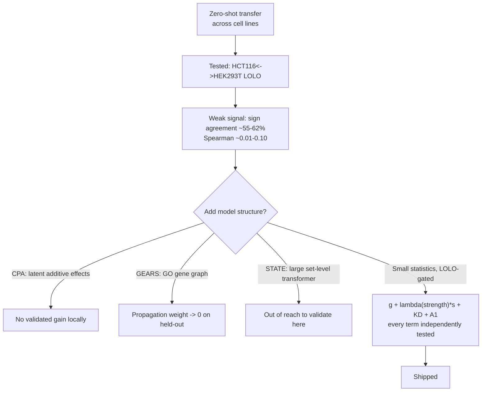
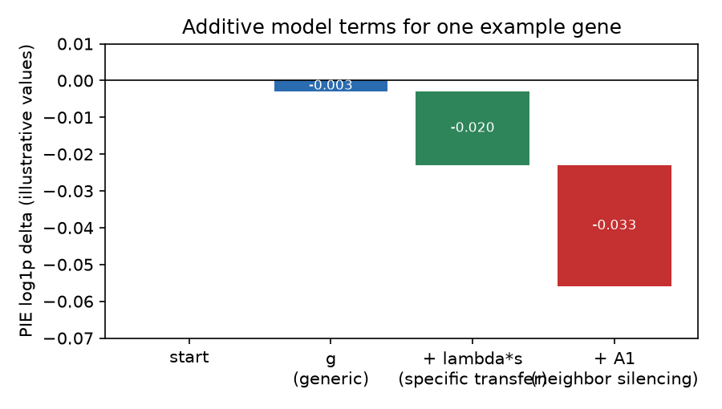
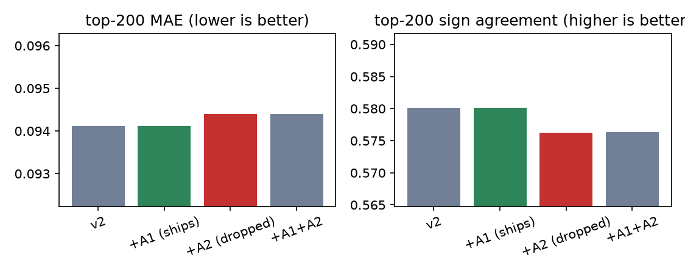
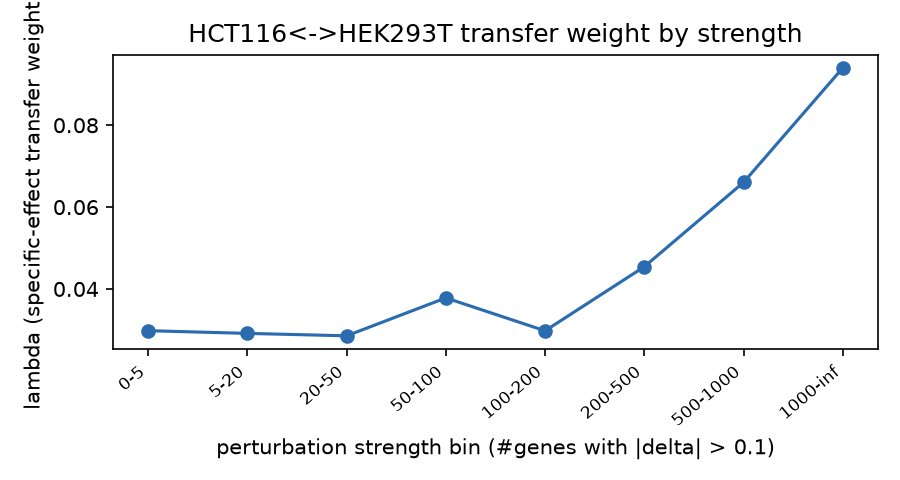
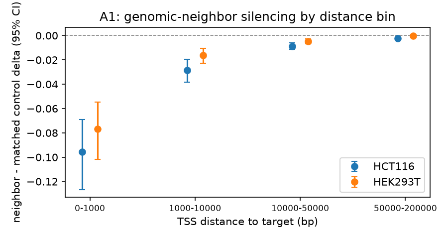
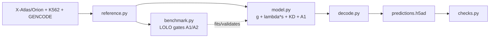

# vcc2026-zero-shot

[](https://github.com/aronratty/vcc2026-zero-shot/actions/workflows/ci.yml)

[](LICENSE)

A small, fully-validated statistical model for zero-shot CRISPRi response
prediction — built for the Arc Institute Virtual Cell Challenge 2026
(final contexts D/E/F). No deep learning, no gene graph, no fine-tuning:
just `g + lambda(strength)*s + KD + A1`, with every term gated by a
held-out benchmark.

## TL;DR

Predict what happens when you knock down each of 300 genes, one at a
time, in **three cell lines the model has never seen a single
perturbation from** — 300 x 3 x 400 cells x 18,533 genes, submitted as
raw integer counts. There's no training set for the task itself; every
part of the model has to transfer in from public Perturb-seq data
collected elsewhere. **Leaderboard rank: TBD — Arc hides 2026 scores
until ~November 19.**

## Why a statistics model, not CPA / GEARS / STATE

I tested cross-line transfer directly: a leave-one-line-out (LOLO)
benchmark between HCT116 and HEK293T, two well-matched reference lines
with 3,277 shared perturbations — about the best case you could hope for.
Result: sign agreement on the true top-200 DE genes was only **55-62%**,
barely above a coin flip. That ceiling, plus the 2025 Virtual Cell
Challenge's own finding that simple pseudobulk statistics often beat deep
models here, is why this repo ships a small, auditable model instead of
one of the more structured published approaches:



CPA (Compositional Perturbation Autoencoder) learns additive latent
effects; GEARS propagates effects through a Gene Ontology graph; STATE is
a much larger set-level transformer. All three are more sophisticated —
but I tried a graph-propagation term here too, and held-out validation
selected a propagation weight of exactly zero. Nothing ships in this repo
that didn't demonstrably help on held-out data.

## The model



| term | what it is |
|---|---|
| `g` | mean delta across all reference perturbations — "what usually happens" |
| `lambda(strength) * s` | a reference line's own response, discounted by a transfer weight fit per strength bin |
| `KD` | fixed 0.10 knockdown prior on the target gene itself (Arc's disclosed guide-selection rule, not fit locally) |
| `A1` | genomic-neighbor silencing — CRISPRi leaks to nearby promoters; shipped after passing a leakage-controlled gate |

A fourth term (A2: strength-scaled `g`) was tested and dropped — it helped
in only one of two transfer directions. See RESULTS.md for every number.

## Results



| model | top-200 MAE | sign agreement | decision |
|---|---:|---:|---|
| v2 baseline | 0.09412 | 0.5801 | — |
| +A1 | 0.09412 | 0.5802 | **ships** |
| +A2 | 0.09440 | 0.5763 | dropped |

A1's gain is real (bootstrap CI on the paired MAE delta excludes 0,
19x more scored rows improve than worsen) but tiny — it touches 522 of
5.56M prediction slots. Not expected to move a real leaderboard score
detectably; shipped because it's correct, not because it's decisive.

 

## Pipeline & repo map



Every function has a one-line docstring — read the module, not the whole
file, to understand any piece:

| module | role |
|---|---|
| [`data.py`](src/vcc_model/data.py) | pure I/O: read challenge/reference files into arrays |
| [`reference.py`](src/vcc_model/reference.py) | align gene axes, build the K562 rank map, index TSS by chromosome |
| [`model.py`](src/vcc_model/model.py) | the effect model itself — every term in `g + lambda*s + KD + A1` |
| [`decode.py`](src/vcc_model/decode.py) | delta -> count-space fold change -> integer counts (the Jensen's-inequality fix) |
| [`benchmark.py`](src/vcc_model/benchmark.py) | the LOLO harness that fits and gates A1/A2 |
| [`checks.py`](src/vcc_model/checks.py) | submission integrity checks (labels, counts, target-gene ratio) |

## Reproduce

```bash
pip install -e ".[dev]"
make download         # GENCODE TSS (automatic) + prints 2 manual data steps
make build-reference   # restrict K562 GWPS to the challenge gene axis
make fit-lolo           # reproduce RESULTS.md + docs/figures
make predict            # build out/predictions.h5ad for D,E,F
make check               # submission integrity checks
make test                 # unit tests (no reference data required)
```

Two reference datasets need a manual pull (see `make download`'s printed
instructions): **X-Atlas/Orion** HCT116/HEK293T
([figshare, CC BY-NC-SA](https://doi.org/10.25452/figshare.plus.29190726))
and **Replogle et al. 2022** K562 GWPS
([Cell](https://doi.org/10.1016/j.cell.2022.05.013) via
[scPerturb](http://projects.sanderlab.org/scperturb/)/pertpy). Neither is
redistributed here. A subset re-run of the full pipeline reproduces the
originally shipped decoded counts bit-for-bit — see RESULTS.md.

## Limitations

No local D/E/F ground truth exists, so none of this is validated against
the real contexts or the (unpublished, for 2026) scoring metric —
HCT116<->HEK293T LOLO is the best available proxy, not a guarantee. See
METHODS.md for the full discussion, including what's learned vs. fixed.

## Acknowledgments

Arc Institute, for the Virtual Cell Challenge 2026; Xaira Therapeutics,
for X-Atlas/Orion; Replogle et al. (2022) and the Weissman lab, for the
K562 GWPS screen; and GENCODE, for the gene annotation.
