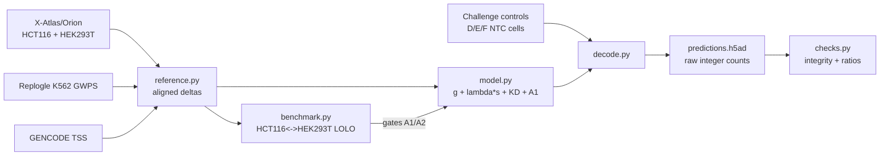

# vcc2026-zero-shot

A small statistical model for zero-shot CRISPRi response prediction, built
for the Arc Institute Virtual Cell Challenge 2026 (final contexts D/E/F).

## 1. TL;DR

The task: predict what happens when you knock down each of 300 genes, one
at a time, in three human cell lines the model has never seen any
perturbation data for — 300 knockdowns x 3 unseen cell lines x 400 cells x
18,533 genes, submitted as raw integer RNA counts. There is no
challenge-provided training set; everything has to transfer from public
Perturb-seq data collected in *other* cell lines.

This repo's approach is deliberately simple: a generic response shared
across reference cell lines, a data-driven transfer weight that scales how
much of a reference line's specific response to trust, an explicit
knockdown prior for the target gene itself, and one small, leakage-tested
addition for CRISPRi's tendency to silence genes near the target's
promoter. No deep learning, no gene-interaction graph, no per-context
fine-tuning. **Final leaderboard rank: TBD — Arc hides 2026 scores until
around November 19.**

## 2. Biology from first principles

A cell isn't one number — it's a vector of RNA counts, one per gene
(18,533 of them here). **CRISPR interference (CRISPRi)** turns a gene down
without cutting DNA: a guide RNA directs a repressor to a target gene's
promoter, so the cell transcribes less of it. It's a knockdown, not
necessarily a knockout. **Perturb-seq** combines that with single-cell RNA
sequencing — thousands of cells, each tagged with the guide it received,
so you can compare "cells that got guide X" against **non-targeting
controls (NTCs)**: cells that received a guide that shouldn't silence
anything, revealing the ordinary cell state plus whatever background noise
the CRISPRi machinery itself introduces.

The desired output for one target gene `g` in one context `c` is a
response vector: `delta[g, c, j] = (mean expression of gene j in g-knockdown
cells) - (mean expression of gene j in that context's NTC cells)`, for every
gene `j`. Most entries are close to zero — knocking down one gene doesn't
usually move most of the transcriptome — but some genes respond strongly:
the target itself (it should drop), and a handful of downstream genes in
the same pathway, or physically close enough on the chromosome to be
affected by CRISPRi's chromatin-level repression.

"Zero-shot in a new cell line" means: we have unperturbed control cells
for the three target contexts (D, E, F), and the list of which 300 genes
to knock down, but zero perturbed examples in those contexts. Everything
about *how a knockdown behaves* has to come from public data collected
elsewhere, and get carried across the gap between "a cell line we have
perturbation data for" and "a cell line we don't."

## 3. What makes it hard, and what I found

The central empirical finding this project rests on: **perturbation
effects transfer weakly, even between two well-matched reference cell
lines.** I tested this directly — a leave-one-line-out (LOLO) benchmark
between HCT116 and HEK293T, two cultured human lines with large
perturbation overlap (3,277 shared knockdowns) in the X-Atlas/Orion
reference data, arguably the *best case* for transfer you could hope for.
Predicting one line's response from the other's gave: all-gene Spearman
correlation median **0.013** (near zero), sign agreement on the true
top-200 differentially-expressed genes only **55-62%** (barely above a
coin flip), and top-200 gene-overlap **10-19%**. That's a real, non-random
signal — but a weak one. If the actual D/E/F contexts are as different
from the reference lines used here as HCT116 and HEK293T are from each
other, this is roughly the ceiling to expect.

That finding shaped every modeling decision below. Several published
approaches model this transfer with more structure: **CPA** (Compositional
Perturbation Autoencoder) learns additive latent perturbation effects that
compose across cell states; **GEARS** propagates a perturbation's effect
through a gene-gene relationship graph built from Gene Ontology; **STATE**
is a recent, much larger set-level transformer trained across many
perturbation datasets. All three are more sophisticated than anything
here. But the 2025 Virtual Cell Challenge's own retrospective found that
simple statistics on pseudobulk profiles often beat deep models at this
task — model capacity isn't obviously the bottleneck; getting the basic
statistics right, honestly validated, is. I tried a graph-propagation term
in an earlier iteration (a co-response graph built from 8,987 HCT116
perturbations) and held-out validation selected a propagation weight of
exactly zero — it didn't help. That result, plus the LOLO ceiling above,
is why this repo ships a small, auditable statistical model instead of a
learned one: every term is independently validated, and nothing survives
that didn't demonstrably help on held-out data.

## 4. The model

```text
predicted_delta = g + lambda(strength) * s + KD + A1
```

- **`g` (generic response):** the mean perturbation delta, averaged across
  every perturbation in the HCT116 and HEK293T reference data. Intuition:
  if you know nothing else about a specific gene's knockdown, your best
  guess for *any* gene's response is "what usually happens when something
  is perturbed" — most perturbations cause a broadly similar stress-ish
  shift in a handful of genes.
- **`s` (specific effect) and `lambda(strength)`:** `s` is a reference
  line's own measured response to that exact target, minus `g`. `lambda`
  is a transfer weight, fit per perturbation-strength bin (`#genes with
  |delta| > 0.1`) on HCT116<->HEK293T held-out transfer — stronger
  perturbations transfer their *specific* direction more reliably
  (`lambda` ranges from 0.03 for weak perturbations to 0.09 for the
  strongest). Example: a target with `s[j] = -0.4` for gene j, strength
  bin lambda=0.05, contributes `-0.02` to that gene's predicted delta —
  heavily discounted, because most of a specific response does not
  transfer between lines.
- **`KD` (knockdown prior):** the target gene's own column gets the fixed
  challenge prior directly — Arc's published guide-selection rule
  (>=80% of guides are required to hit at least some threshold knockdown)
  implies roughly 10% residual expression, so the decoder sets
  `fc = 0.10` on the target gene exactly, overriding whatever the
  statistical terms above would have predicted for it.
- **`A1` (genomic-neighbor silencing, shipped):** CRISPRi represses
  chromatin around the target's promoter, so a gene whose own promoter
  sits within ~50kb can be knocked down too, especially bidirectional
  promoters within 1kb. Fit as one additive delta per TSS-distance bin
  (0-1kb, 1-10kb, 10-50kb — a 50-200kb bin was tested and rejected, see
  RESULTS.md), from the median difference between neighbor genes' deltas
  and distance/expression-matched control genes'. Example: a neighbor gene
  800bp from a knocked-down target gets an extra `-0.033` added to its
  predicted delta, on top of whatever `g + lambda*s` already predicted for
  it — never applied to the target gene itself.

A fourth term, a strength-scaled version of `g` (the idea that *how
strong* a perturbation is might transfer better than *which direction* it
moves genes), was tested and dropped — see RESULTS.md "A2."

## 5. What's learned vs. fixed

Being explicit about this matters: the challenge rules require disclosing
non-learned components.

| Component | Learned or fixed | From |
|---|---|---|
| `g` | Fixed (a mean, not fit to any held-out objective) | Average over all HCT116+HEK293T perturbations |
| `lambda(strength)` | **Learned** | Least-squares fit per strength bin, 5-fold CV + even/odd LOLO validated |
| `KD = 0.10` | **Fixed** | Arc's disclosed >=80% guide-selection rule, not estimated from data |
| A1 bin effects | **Learned**, bin selection is a fixed decision rule | Median matched-control-adjusted delta per bin; bin inclusion gated by "CI excludes 0 in both lines" |
| K562 quantile map | **Learned** (rank mapping only; magnitude source is fixed) | K562 CD-coefficient rank, remapped onto HCT116's own delta-magnitude distribution |

## 6. From deltas to cells

The reference cache stores *log1p-normalized* deltas, not count-space
fold changes. Converting with a naive `exp(delta)` is a real bug this
project caught and fixed: for a gene at control mean log1p(CP10k)=1.0 with
delta=-0.2, `exp(-0.2) ≈ 0.819` (an 18% drop) — but the mathematically
correct count-space ratio, `expm1(0.8)/expm1(1.0) ≈ 0.709` (a 29% drop),
is nearly double. This matters most for a knockdown target itself: a 70%
true knockdown at low-to-medium expression was previously being decoded
as something closer to a 35% drop. `src/vcc_model/decode.py` implements
the corrected formula (`fc = expm1(m_ctx + delta) / expm1(m_ctx)`), with a
regression test (`tests/test_decode.py`) pinned to this exact bug.

Fold changes are converted to integer counts by resampling real NTC cells
from that context's own controls (never synthetic cells) and perturbing
each gene's count: **Binomial thinning** `Binomial(count, fc)` for
`fc < 1`, and `count + Poisson(count * (fc - 1))` for `fc > 1`. Using real
control cells as the base preserves the realistic per-cell structure
(library size, sparsity pattern) that a from-scratch synthetic cell
wouldn't have.

## 7. Validation



- **Decoder unit tests** (`tests/test_decode.py`): pin the Jensen's-
  inequality fix, the sparse-gene floor, the exact target-fc override, and
  the non-target fold-change cap — plus a determinism check and an
  expectation check on the Binomial/Poisson decode.
- **Model unit tests** (`tests/test_model.py`): the knockdown prior's
  sign, the lambda-bin lookup including fallback, and — the one that
  matters most for A1 — that the neighbor term *never* touches the target
  gene's own column.
- **Submission integrity checks** (`src/vcc_model/checks.py` /
  `scripts/05_check_submission.py`): exact cell counts per
  (context, target) group, no leaked `non-targeting` labels, nonnegative
  integer counts (sampled), and the target-gene mean-count ratio against
  controls (should land near the fixed 0.10 prior in every context).
- **Ablation table** (RESULTS.md, real numbers from `scripts/03_fit_lolo.py`):
  v2 baseline, +A1, +A2, +A1+A2, all scored on the identical held-out
  target subset. A1 improves both MAE and sign agreement in all 4 LOLO
  scoring cells and ships; A2 improves only one of two transfer directions
  and is dropped.
- **Subset-reproduction proof**: re-running the full pipeline (model +
  decode) on a 5-target, single-context subset with the same seed
  reproduces the originally shipped decoded counts bit-for-bit (the raw
  delta matrix matches to float32 rounding, ~3e-8), confirming this
  refactor didn't change the model.

## 8. Limitations and next steps

- **No local D/E/F ground truth.** Nothing here can be validated against
  the real challenge contexts or the actual (unpublished, for 2026)
  scoring metric. HCT116<->HEK293T LOLO is the most rigorous available
  proxy, not a guarantee — see RESULTS.md "What this predicts about the
  real D/E/F submission" for a magnitude argument about why A1's effect,
  while statistically real, is unlikely to move a real leaderboard score
  detectably (it touches 522 of 5,559,900 prediction slots).
- **No per-context adaptation.** The model doesn't use the target
  contexts' own control profiles beyond the decoder's fold-change
  conversion — it could plausibly do better by damping predicted effects
  for genes that are barely expressed in a specific target context.
- **Two reference lines carry almost the whole model.** Coverage gaps
  (K562-only or no-reference targets) fall back to progressively weaker
  priors; a third or fourth well-matched reference line would likely help
  more than any single additional statistical term.
- **The A1 TSS/control-matching is simple** (median-based, one control
  match per neighbor gene). A proper regression against distance and
  expression jointly, or a larger genomic-neighbor dataset, would sharpen
  the bin effect estimates.

## 9. Reproduce

```bash
pip install -e ".[dev]"
```

Two reference datasets are required and are **not downloaded
automatically** (see `scripts/01_download_references.py`'s printed
instructions for the exact file schema expected):

1. **X-Atlas/Orion** (Xaira Therapeutics, 2025) HCT116/HEK293T Perturb-seq
   — [doi.org/10.25452/figshare.plus.29190726](https://doi.org/10.25452/figshare.plus.29190726).
   License: **CC BY-NC-SA** (non-commercial). This pipeline consumes a
   compact per-perturbation pseudobulk-delta cache derived from the raw
   ~520GB release, at `paths.xatlas_cache` in `config.yaml`.
2. **Replogle et al. 2022** genome-wide CRISPRi Perturb-seq in K562 (Cell,
   [doi.org/10.1016/j.cell.2022.05.013](https://doi.org/10.1016/j.cell.2022.05.013);
   bioRxiv [10.1101/2021.12.16.473013](https://doi.org/10.1101/2021.12.16.473013)).
   Processed signatures via [scPerturb](http://projects.sanderlab.org/scperturb/)
   or pertpy's `pertpy.data.replogle_2022_k562_gwps()`. Raw per-gene text
   table expected at `paths.k562_gwps_raw`.

GENCODE v44 TSS coordinates download automatically (public, no license
friction).

```bash
make download        # GENCODE TSS (automatic) + prints the two manual steps above
make build-reference  # restrict K562 GWPS to the challenge gene axis
make fit-lolo          # reproduce RESULTS.md's numbers + docs/figures
make predict           # build out/predictions.h5ad for contexts D,E,F
make check             # submission integrity checks
make test               # unit tests (no reference data required)
```

## 10. Acknowledgments

Arc Institute, for designing and running the Virtual Cell Challenge 2026;
Xaira Therapeutics, for the X-Atlas/Orion Perturb-seq dataset; Replogle et
al. (2022) and the Weissman lab, for the genome-wide K562 CRISPRi
Perturb-seq screen; and the GENCODE project, for the gene annotation used
to derive TSS coordinates.
