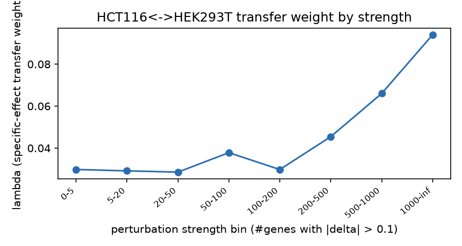
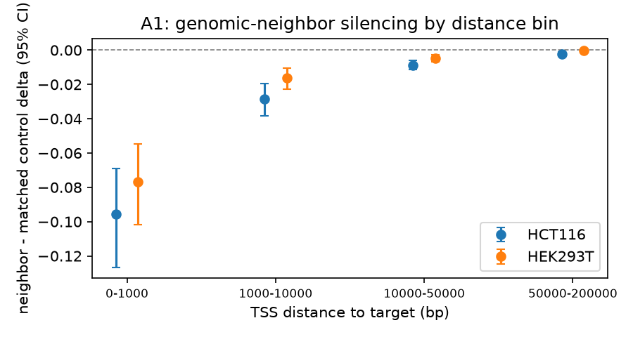
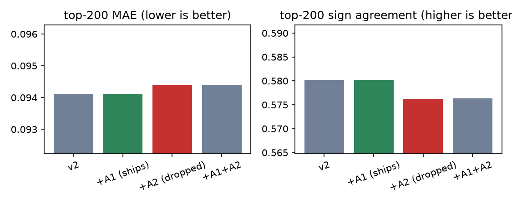

# Results

All numbers below were produced by `scripts/03_fit_lolo.py` against the
real reference caches and are reproduced bit-for-bit by `make fit-lolo`
(see "Validation" in README.md for the subset-reproduction proof). Figures
are in `docs/figures/`, generated by `scripts/06_make_figures.py` from
this run's `out/lolo_report.json`.

## HCT116<->HEK293T LOLO baseline

Fit on 3,277 shared perturbations. `lambda(strength)` ():

| strength bin | lambda (mean of both directions) |
|---|---:|
| 0-5 | 0.0298 |
| 5-20 | 0.0291 |
| 20-50 | 0.0286 |
| 50-100 | 0.0378 |
| 100-200 | 0.0298 |
| 200-500 | 0.0454 |
| 500-1000 | 0.0660 |
| >1000 | 0.0940 |

## A1: genomic-neighbor silencing

TSS coordinates mapped for 18,121/18,533 challenge genes (GENCODE v44
basic); 1,210 of the 3,277 shared perturbations had a mapped TSS.
Neighbor-vs-matched-control delta difference by bin and line
():

| line | bin | n | median delta | frac negative | diff mean | 95% CI |
|---|---|---:|---:|---:|---:|---|
| HCT116 | 0-1kb | 94 | -0.0396 | 0.862 | -0.0957 | [-0.1267, -0.0689] |
| HCT116 | 1-10kb | 255 | -0.0070 | 0.753 | -0.0285 | [-0.0383, -0.0194] |
| HCT116 | 10-50kb | 1515 | -0.0019 | 0.625 | -0.0087 | [-0.0115, -0.0060] |
| HCT116 | 50-200kb | 5183 | -0.0007 | 0.585 | -0.0022 | [-0.0033, -0.0011] |
| HEK293T | 0-1kb | 94 | -0.0394 | 0.872 | -0.0768 | [-0.1017, -0.0545] |
| HEK293T | 1-10kb | 255 | -0.0066 | 0.765 | -0.0163 | [-0.0229, -0.0103] |
| HEK293T | 10-50kb | 1515 | -0.0013 | 0.630 | -0.0047 | [-0.0067, -0.0029] |
| HEK293T | 50-200kb | 5183 | -0.0006 | 0.584 | -0.0003 | [-0.0013, 0.0006] |

0-1kb/1-10kb/10-50kb qualify (CI excludes 0 in both lines); 50-200kb does
not (HEK293T crosses 0) and is excluded from the model.

Even/odd-split fit/score gate (both transfer directions, both orders):

| direction | fit→score | baseline MAE | +A1 MAE | baseline sign | +A1 sign |
|---|---|---:|---:|---:|---:|
| HCT→HEK | evens→odds | 0.089931 | 0.089928 | 0.61041 | 0.61046 |
| HCT→HEK | odds→evens | 0.089127 | 0.089120 | 0.62059 | 0.62065 |
| HEK→HCT | evens→odds | 0.099624 | 0.099619 | 0.53847 | 0.53851 |
| HEK→HCT | odds→evens | 0.097802 | 0.097796 | 0.55093 | 0.55098 |

Improves both MAE and sign agreement in all 4 cells — ships. The effect is
real (bootstrap CI on the mean paired MAE delta across all scored rows
excludes 0) but small: it only changes 7.4% of scored (direction, target)
rows at all, and among rows it does touch, it improves MAE 19x more often
than it worsens it (consistent direction, not noise) — but the magnitude
is a ~5e-6 absolute MAE shift on a baseline of ~0.09.

## A2: strength-scaled generic response

Strength Spearman correlation between HCT116 and HEK293T: **0.811**
(p≈0, n=3,277) — passes the 0.3 go/no-go gate.

| direction | fit→score | baseline MAE | +A2 MAE | baseline sign | +A2 sign |
|---|---|---:|---:|---:|---:|
| HCT→HEK | evens→odds | 0.081488 | 0.082339 | 0.59507 | 0.59328 |
| HCT→HEK | odds→evens | 0.082222 | 0.082900 | 0.58333 | 0.57940 |
| HEK→HCT | evens→odds | 0.090804 | 0.090728 | 0.53100 | 0.53334 |
| HEK→HCT | odds→evens | 0.091024 | 0.090992 | 0.53315 | 0.53386 |

Improves both metrics only in HEK→HCT; worsens both in HCT→HEK — dropped.

## Combined ablation (same 1,210-target shared_with_tss subset, mean of all 4 scoring cells)

| model | top-200 MAE | sign agreement | top-200 overlap | decision |
|---|---:|---:|---:|---|
| v2 baseline | 0.094121 | 0.58010 | 0.14080 | — |
| +A1 | 0.094116 | 0.58015 | 0.14087 | **ships** |
| +A2 | 0.094404 | 0.57628 | 0.13117 | dropped |
| +A1+A2 | 0.094398 | 0.57633 | 0.13124 | dropped (A2 drags it below baseline) |

A1 and A2's individual gate tables above use different target populations
(A1 needs a mapped TSS; A2 doesn't), so their own baselines aren't
comparable bar-to-bar — this combined table restricts all four variants to
the same shared_with_tss subset for a fair comparison.

## What this predicts about the real D/E/F submission

The shipped model touches 522 of 5,559,900 (target, gene) prediction
slots (196/300 final targets have at least one qualifying neighbor gene).
This is not expected to move the real leaderboard score by a detectable
amount — the A1 effect is ~4-5 orders of magnitude smaller than the
model's own baseline error, and the LOLO test here is a proxy (a different
pair of cell lines) for the real zero-shot transfer to D/E/F, whose metric
is unpublished for 2026. See README "Limitations and next steps".
